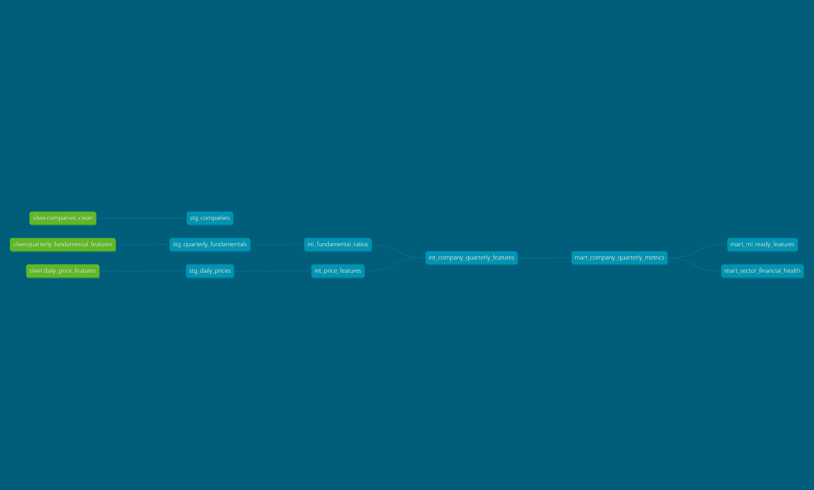

# Financial Lakehouse Analytics Pipeline

## Overview

This repository is a local financial lakehouse pipeline built around synthetic market and fundamentals data. It uses PySpark for raw-to-silver ETL, Parquet for analytical storage, and dbt with DuckDB to build tested marts with lineage-aware documentation.

The project is intentionally local-first. It focuses on reproducible analytics engineering, not cloud orchestration, BI dashboards, or model serving.

## Technical Demo

[dbt Docs & Technical Demo](https://diegokusterr.github.io/financial-lakehouse-analytics-pipeline/dbt-docs/#!/overview)

This link opens the static dbt Docs technical demo directly at the overview page. It is a static documentation build, not a live dashboard or live data application.

## Why This Project Exists

Many portfolio projects stop at notebooks or screenshots. This repository was built to show a fuller analytics workflow:

- synthetic raw data generation
- typed ingestion and ETL in PySpark
- Parquet-based intermediate storage
- dbt modeling with staging, intermediate, and mart layers
- local analytical execution in DuckDB
- documented lineage and repeatable data-quality checks

## Architecture

```text
Synthetic CSV generator
        |
        v
data/raw/
  - companies.csv
  - daily_prices.csv
  - quarterly_fundamentals.csv
        |
        v
PySpark ETL
  - schema checks
  - type casting
  - deduplication
  - standardization
  - window-based features
        |
        v
data/silver/ Parquet datasets
        |
        v
dbt + DuckDB
  - staging models
  - intermediate models
  - marts
  - schema tests
  - docs + lineage
        |
        v
data/gold/ analytical outputs
```



The public demo is generated from this dbt layer and exposes model lineage, documentation, sources, and tests without adding a separate dashboard tool.

## Key Engineering Decisions

- Synthetic source data keeps the repository runnable without external data contracts or licensed financial feeds.
- PySpark is used for the ETL layer so cleaning, typing, deduplication, and window features are expressed in distributed-style data transformations rather than notebook-only pandas code.
- Parquet separates storage from modeling and keeps the handoff between ETL and analytics layers explicit.
- DuckDB plus dbt keeps the analytical layer local, SQL-focused, and reproducible.
- A small helper class under `src/spark_support/` is included so local Spark Parquet writes stay stable on Windows.

## Data Model

The project uses three raw entities and three analytical marts.

Raw inputs:

- `companies`: company dimension data
- `daily_prices`: daily market observations
- `quarterly_fundamentals`: quarterly financial statement metrics

Final marts:

- `mart_company_quarterly_metrics`: company-quarter level analytical view
- `mart_sector_financial_health`: sector-level rollup
- `mart_ml_ready_features`: downstream-ready feature table for later modeling work

## PySpark Layer

The PySpark layer lives in `src/spark_etl.py` and creates the silver datasets.

Main responsibilities:

- validate required columns
- cast date and numeric fields
- remove duplicate rows
- standardize tickers and sector values
- forward-fill prices and use trailing observed volume averages; reject missing prices with no past observation
- preserve missing fundamentals as NULL and track their publication dates
- calculate daily returns
- calculate rolling price features
- prepare quarterly company features for downstream SQL modeling

## dbt and DuckDB Layer

The dbt project lives in `dbt_finance/` and uses DuckDB as the local analytical engine.

This layer demonstrates:

- staging models over the curated Parquet inputs
- intermediate transformations for reusable analytical logic
- mart models for reporting-ready and ML-ready outputs
- documentation and lineage through dbt Docs
- schema tests embedded in the model layer

## Data Quality and Testing

Quality checks are applied in more than one layer:

- schema and typing checks happen during the PySpark ETL step
- dbt schema tests validate model expectations in the SQL layer
- `src/validate_outputs.py` scans Parquet contents, queries DuckDB marts, and reconciles row counts against the supplied raw inputs
- `tests/` exercises the production Spark functions and actual dbt SQL with small regression fixtures
- singular dbt tests check financial validity, consecutive-quarter relationships, publication dates, and ML labels

## Tech Stack

- Python 3.11
- PySpark / Apache Spark
- Parquet
- dbt Core
- dbt-duckdb
- DuckDB
- Pandas and NumPy for synthetic data generation
- Make for repeatable local commands

## Selected Repository Structure

```text
financial-lakehouse-analytics-pipeline/
|-- data/
|   |-- raw/
|   |-- silver/
|   `-- gold/
|-- src/
|   |-- spark_support/
|   |-- generate_synthetic_data.py
|   |-- spark_etl.py
|   |-- build_technical_demo.py
|   `-- validate_outputs.py
|-- dbt_finance/
|   |-- dbt_project.yml
|   |-- profiles.yml.example
|   `-- models/
|-- docs/
|   |-- architecture.md
|   `-- data_dictionary.md
|-- docs-demo/
|-- tests/
|-- Makefile
`-- README.md
```

## Run Locally

Use a fresh checkout or an isolated copy for the synthetic run. Generation and ETL commands replace their synthetic outputs; do not point them at datasets you need to retain.

Tested locally on Windows with **Python 3.11.9 and Temurin JDK 17.0.16**. Actions uses Python 3.11 / Java 17 on Ubuntu. The package versions are constrained in `constraints.txt`; see [reproducibility details](docs/reproducibility.md).

1. Install Python 3.11 and a JDK 17 using your normal trusted installation process. A JRE alone is insufficient: Windows support compiles a Java class with `javac`. Set `JAVA_HOME` to the JDK directory and put its `bin` directory on PATH, for example in the current PowerShell session:

```powershell
$env:JAVA_HOME = "C:\Path\To\jdk-17"
$env:Path = "$env:JAVA_HOME\bin;$env:Path"
java -version
javac -version
```

2. For native Windows execution, this project's Spark setup requires a compatible, trusted `winutils.exe`. The pinned Spark distribution uses Hadoop 3.3.4. If your existing Hadoop installation provides it, set:

```powershell
$env:HADOOP_HOME = "C:\Path\To\hadoop"
Test-Path "$env:HADOOP_HOME\bin\winutils.exe"
```

The final command must return `True`. The code also recognizes a copy on PATH or the existing RStudio installation locations listed in `src/spark_etl.py`; RStudio is not a required dependency. The Java support class does **not** replace `winutils.exe`. This project does not download Hadoop binaries. On Linux or WSL, use Linux Python/Java and skip the Windows helper and winutils setup.

3. Create and activate a virtual environment.

```powershell
py -3.11 -m venv .venv
.\.venv\Scripts\Activate.ps1
```

If activation is blocked by your PowerShell policy, invoke `.\.venv\Scripts\python.exe` and `.\.venv\Scripts\dbt.exe` directly instead of changing that policy.

4. Install the constrained runtime and test dependencies. Make is optional; all commands below work directly in PowerShell.

```powershell
python -m pip install -r requirements-dev.txt
```

5. From the repository root, create the local dbt profile and run the regression tests.

```powershell
Copy-Item dbt_finance/profiles.yml.example dbt_finance/profiles.yml
python -m pytest tests -q
```

6. Generate synthetic inputs and run the raw-to-silver ETL.

```powershell
python src/generate_synthetic_data.py
python src/spark_etl.py
```

The fundamentals input now requires `available_date`. For existing synthetic files, regenerate them in a fresh workspace. For other inputs, supply their actual publication dates; do not infer availability from the quarter identifier.

7. Build the dbt models and run all dbt tests. Stop if any command fails.

```powershell
dbt run --project-dir dbt_finance --profiles-dir dbt_finance
dbt test --project-dir dbt_finance --profiles-dir dbt_finance
if ($LASTEXITCODE -ne 0) { throw "dbt tests failed." }
Copy-Item dbt_finance/target/run_results.json dbt_finance/target/test_run_results.json
```

8. Validate actual outputs, generate Docs and build the local static demo.

```powershell
python src/validate_outputs.py
dbt docs generate --project-dir dbt_finance --profiles-dir dbt_finance
python src/build_technical_demo.py
```

`test_run_results.json` preserves executed test results. The later `run_results.json` describes Docs generation and must not be presented as evidence that data tests executed. Actions retains the separate test results and resolved package versions as its `pipeline-validation` artifact.

If GNU Make is already available, the equivalent targets are `make install`, `make test`, `make generate-data`, `make spark-etl`, `make dbt-run`, `make dbt-test`, `make validate`, `make dbt-docs`, and `make build-demo`.

Optional local preview:

```powershell
python -m http.server 8080 --directory docs-demo
```

## Limitations

- The repository uses synthetic data, so it demonstrates pipeline design rather than real market coverage.
- The project is intentionally local-first and does not include orchestration, cloud infrastructure, or BI serving layers.
- The public demo is a static dbt Docs build, not a live query service.
- Quarterly feature rows become available on `feature_available_date`, never at the start of the represented quarter. Synthetic publication is assumed to be 45 days after quarter end; real reporting calendars and restatement histories are not modeled.
- `mart_ml_ready_features` retains all feature rows. Unknown next-quarter outcomes remain NULL; use `is_training_eligible = true` for rows with known consecutive-quarter outcomes available after the features. Select predictors explicitly: outcome columns are targets/metadata, never inputs. Use temporal splits based on availability dates, and handle remaining feature NULLs within training folds.
